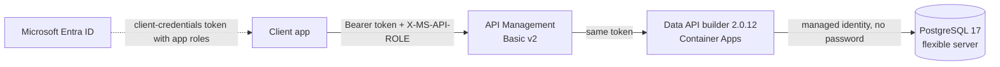

# Hyperspectral imagery API: APIM → Data API builder → PostgreSQL

A small demo that publishes synthetic hyperspectral imagery through
[Azure API Management](https://learn.microsoft.com/azure/api-management/),
[Data API builder (DAB)](https://learn.microsoft.com/azure/data-api-builder/) on Azure Container Apps,
and Azure Database for PostgreSQL flexible server. It shows two things:

- **Selective, bounded queries:** chosen fields, supported filters, an explicit grain
  and sort order, and controlled pages followed through `nextLink`.
- **Authorization at every layer:** Microsoft Entra ID → APIM → DAB → PostgreSQL. Each
  layer is proven by a scripted negative test.

There is no application code. DAB serves a reviewed JSON configuration from
Microsoft's pinned image, and Terraform provisions everything in one `apply`.

> This is a teaching template, not a production platform. The imagery, missions,
> identities and coordinates are synthetic.

## Architecture



| Component | What this repo configures |
|---|---|
| Entra ID | An API app registration with three app roles, plus three demo client apps holding one role each |
| API Management | Token validation, role check, query-shape guardrails, a per-client rate limit, and two `GET` operations |
| Data API builder | Two read-only entities with field-level and row-level permissions per role ([`dab/dab-config.json`](dab/dab-config.json)) |
| PostgreSQL | Entra-only sign-in; a managed-identity login that can read published columns only; row-level security |

## The data and the contract

The generator in [`sql/20-synthetic-data.sql`](sql/20-synthetic-data.sql) builds 8 scenes, 4 per
mission. Each scene is a 32 × 32-pixel cube with 64 bands from 400 to 2500 nm, about
524,000 reflectance samples in total. Every pixel is water, vegetation, soil or built
surface, and its spectrum has that material's recognizable shape: the vegetation red
edge, near-zero water in the near infrared, and the clay feature in soil. The
atmospheric water-vapour bands near 1400 and 1900 nm are darkened and flagged.
`A-0004` and `B-0004` are embargoed.

| Endpoint | Grain | Default order and tie-break | Fields | Bounds |
|---|---|---|---|---|
| `GET /api/scenes` | one scene acquisition | `scene_id` | `scene_id`, `mission_id`, `sensor`, `acquired_at`, `center_lat`, `center_lon`, `cloud_cover_pct`, `gsd_m`, `width_px`, `height_px`, `band_count` | up to 500 rows per page |
| `GET /api/spectra` | one reflectance sample per scene × pixel × band | `scene_id`, `pixel_row`, `pixel_col`, `band_id` | `scene_id`, `mission_id`, `pixel_row`, `pixel_col`, `band_id`, `wavelength_nm`, `reflectance`, `quality_flag` | must filter one `scene_id`; no `or`; up to 500 rows per page; 5 s database timeout |

Clients use DAB's REST keywords, which APIM passes through:

| Keyword | Purpose |
|---|---|
| `$select` | which fields to return |
| `$filter` | which rows (OData: `eq`, `ge`, `le`, `and`, …) |
| `$orderby` | the sort order; DAB appends the remaining key columns so paging is deterministic |
| `$first` | page size, from 1 to 500 |
| `$after` | continuation; always follow the returned `nextLink` instead of building it yourself |

The base tables hold columns that the API never publishes (`release_status`, `raw_uri`,
`processing_note`). Clients can't select them, and neither can the API's database
login.

## Authorization at every layer

| Layer | Enforces | Where | Proven by `demo.sh` step |
|---|---|---|---|
| Entra ID | Only clients assigned an app role can get a token; roles arrive in the `roles` claim | [`infra/entra.tf`](infra/entra.tf) | all steps (3 clients) |
| APIM | A valid v2 token for this API with a known role → else **401**. `X-MS-API-ROLE` must be one of the caller's roles → else **403**. Only `$select/$filter/$orderby/$first/$after`, with `$first` from 1 to 500 → else **400**. Spectra must filter `scene_id eq '…'` without `or` → else **400**. Only the two `GET` operations exist. Rate limit per client. | [`infra/policies/`](infra/policies) | 1, 7, 9, 10 |
| DAB | Validates the same token again, so bypassing APIM doesn't bypass authorization. Entity: `catalog-viewer` can't read spectra. Field: `catalog-viewer` can't see coordinates. Row: analysts see their own mission only. Read is the only action. | [`dab/dab-config.json`](dab/dab-config.json) | 2–6, 8–10 |
| PostgreSQL | DAB signs in as its managed identity, with no password anywhere. That login belongs to `api_reader`, which has column-level `SELECT` on published columns only and no write privileges. Row-level security hides embargoed scenes and their spectra. Sessions are read-only, with a 5 s statement timeout and a connection limit. | [`sql/30-access.sql`](sql/30-access.sql), [`sql/40-api-login.sql`](sql/40-api-login.sql) | 2, 3, 11 |

The three demo clients:

| Client | App role / DAB role | Scenes | Spectra |
|---|---|---|---|
| `analyst-a` | `mission-a-analyst` | Mission A, all fields | Mission A |
| `analyst-b` | `mission-b-analyst` | Mission B, all fields | Mission B |
| `catalog` | `catalog-viewer` | Both missions, no coordinates | Denied |

**Who filters which rows.** DAB can't pass caller claims to PostgreSQL: session context
and On-Behalf-Of sign-in are SQL Server-only features. So the per-caller mission filter
is a DAB *database policy* (`@item.mission_id eq 'A'`). DAB turns it into a SQL `WHERE`
clause, which PostgreSQL executes. PostgreSQL adds its own floor that holds whatever the
API configuration says. Step 3 shows this: `catalog-viewer` has no DAB row policy, yet
embargoed scenes still never appear.

## Run it

Before you start:
- You need an Azure subscription where you can create resources and Entra app
  registrations.
- Install the [Azure CLI](https://learn.microsoft.com/cli/azure/install-azure-cli),
  Terraform ≥ 1.9 and Docker.
- For the bash scripts you also need `jq` and `curl`. The PowerShell scripts need
  [PowerShell 7.4+](https://learn.microsoft.com/powershell/scripting/install/installing-powershell)
  instead, and run on Windows, macOS and Linux.
- APIM Basic v2 is billed by the hour, so run the `down` script when you finish.

Every script comes in both flavours and they behave the same:

| Step | bash | PowerShell |
|---|---|---|
| Sign in and select the subscription | `az login` | `az login` |
| Deploy, seed PostgreSQL, wait for the API | `bash scripts/up.sh` | `pwsh ./scripts/up.ps1` |
| Run the 11 asserted steps (exits non-zero on any surprise) | `bash scripts/demo.sh` | `pwsh ./scripts/demo.ps1` |
| Delete everything, including the app registrations | `bash scripts/down.sh` | `pwsh ./scripts/down.ps1` |
| Offline check, no Azure needed | `bash scripts/test-local.sh` | `pwsh ./scripts/test-local.ps1` |

The `up` script takes the subscription and publisher email from `az account show`,
deploys to `westus3`, and opens the PostgreSQL firewall to this machine's public IP.
To override these, set the environment variables `PUBLISHER_EMAIL`, `LOCATION` or
`OPERATOR_IP`, or pass the PowerShell parameters `-PublisherEmail`, `-Location` or
`-OperatorIp`. For example: `LOCATION=eastus2 bash scripts/up.sh` or
`pwsh ./scripts/up.ps1 -Location eastus2`.

The values are saved in the gitignored `infra/terraform.tfvars.json`. Terraform shows
its plan and asks before changing anything; to skip that prompt, set `AUTO_APPROVE=1`
or pass `-AutoApprove`. New Entra role assignments can take a few minutes to appear in
tokens, so the `up` script keeps retrying until APIM answers. Running it again is safe:
it only re-seeds the disposable data, and it updates the firewall rule if your IP has
changed.

The offline check loads the SQL into a throwaway PostgreSQL as a non-superuser admin
(as on Azure), runs the database-layer assertions, and starts the pinned DAB image
against the published views. CI runs both versions.

## Try a request yourself

```sh
cd infra
tenant=$(terraform output -raw tenant_id)
scope=$(terraform output -raw api_scope)
api=$(terraform output -raw apim_gateway_url)/api
client=$(terraform output -json clients | jq '."analyst-a"')

token=$(curl -s "https://login.microsoftonline.com/$tenant/oauth2/v2.0/token" \
  --data-urlencode "client_id=$(jq -r .client_id <<<"$client")" \
  --data-urlencode "client_secret=$(jq -r .client_secret <<<"$client")" \
  --data-urlencode "scope=$scope" \
  --data-urlencode grant_type=client_credentials | jq -r .access_token)

# Red-edge window for one scene, pixel-major order, 200 samples per page.
curl -s --get "$api/spectra" \
  -H "Authorization: Bearer $token" \
  -H 'X-MS-API-ROLE: mission-a-analyst' \
  --data-urlencode '$select=pixel_row,pixel_col,wavelength_nm,reflectance' \
  --data-urlencode "\$filter=scene_id eq 'A-0002' and wavelength_nm ge 650 and wavelength_nm le 900" \
  --data-urlencode '$orderby=pixel_row asc,pixel_col asc,wavelength_nm asc' \
  --data-urlencode '$first=200' | jq '{rows: (.value | length), first: .value[0], nextLink}'
```

`nextLink` is relative (`/api/spectra?...&$after=...`). Prefix it with the APIM gateway
URL, keep the same headers, and request it as is. A continuation is a position in a
live query, not a frozen snapshot. If clients need a repeatable as-of dataset, publish
a versioned extract instead.

## Repository layout

```text
dab/dab-config.json     The whole API: entities, fields, roles, row policies, paging
sql/10-schema.sql       Private tables (imagery) and versioned views (api.*_v1)
sql/20-synthetic-data.sql  Deterministic generator; psql -v grid=8 -v bands=16 shrinks it
sql/30-access.sql       api_reader role, column grants, row-level security
sql/40-api-login.sql    Grants a login api_reader and its session guardrails
sql/50-assertions.sql   Database-floor assertions, run as api_reader
sql/azure/              Creates the PostgreSQL role for DAB's managed identity
infra/                  Terraform: Entra, PostgreSQL, Container Apps, APIM and policies
scripts/                up, demo, down, and test-local, in bash (.sh) and PowerShell (.ps1)
docs/workshop.md        A 20-minute facilitation flow
```

## Demo shortcuts and production hardening

| Demo choice | Why it's here | Production alternative |
|---|---|---|
| PostgreSQL public endpoint, firewall open to Azure services and the operator | No virtual network to build | Private access in a virtual network; seed from an approved runner |
| Public Container Apps ingress | APIM Basic v2 has no virtual network integration | Internal environment, with APIM Standard v2 or Premium in the network. DAB's own token check is why a bypass still fails today (step 9). |
| DAB config shipped as a Container Apps secret file | No registry or image build | A thin image (`FROM` the pinned DAB image, `COPY` the config), scanned and deployed by digest |
| Client secrets in local Terraform state | One-command demo | Certificate or federated credentials; remote, encrypted state |
| `max-response-size-mb` unset | DAB 2.0.12 can fail while streaming PostgreSQL JSON results with it set | Narrow fields and the 500-row page cap bound responses today; enforce byte limits at the gateway until a tested DAB release fixes this |

## When to use custom code

DAB fits when the contract is reviewed entities, selected fields, supported filters,
pagination, and declarative permissions. Keep or add a custom API when the requirement
genuinely needs orchestration, nonstandard contracts, cross-service logic, or an export
workflow. For example, return whole pixel spectra as arrays, or serve band images as
files. Compare both approaches against the same contract and the same negative-access
tests rather than rewriting by default.

## License

[MIT](LICENSE)
